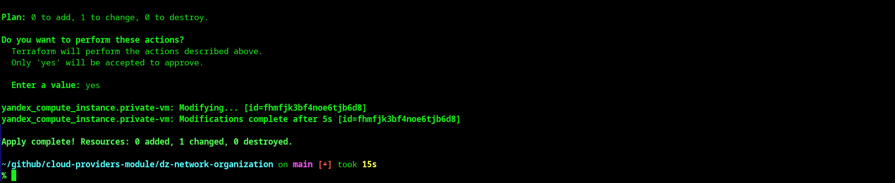
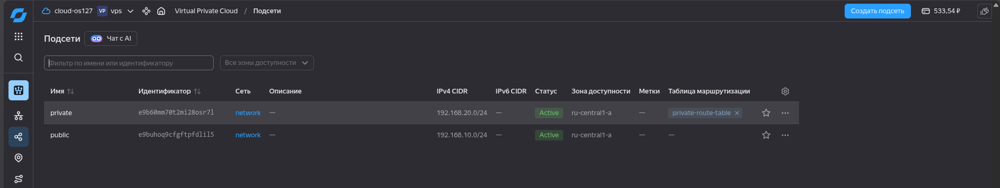
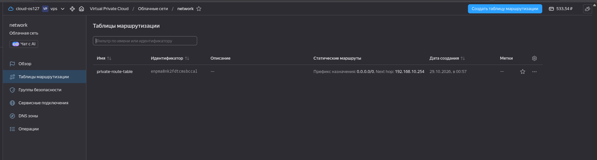
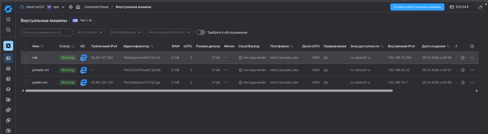
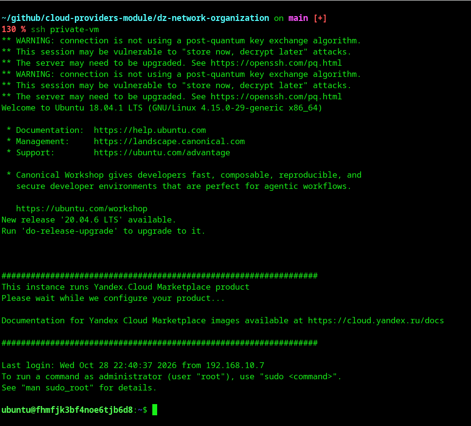
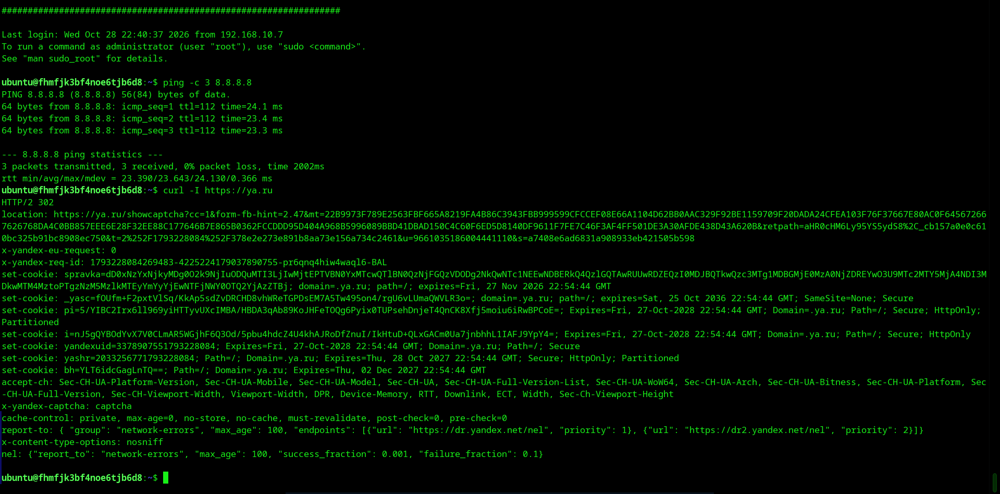

# Домашнее задание "Организация сети"

## Описание

Развёрнута инфраструктура в Yandex Cloud с использованием Terraform, состоящая из:
- VPC с двумя подсетями (публичной и приватной)
- NAT-инстанса для обеспечения доступа в интернет из приватной подсети
- Публичной виртуальной машины с доступом в интернет
- Приватной виртуальной машины без публичного IP, доступ к которой осуществляется через SSH Jump Host

## Архитектура

```
[Мой ПК] 
    → SSH → [public-vm] (62.84.125.120)
                → SSH → [private-vm] (192.168.20.32)
                            → NAT (192.168.10.254) → Интернет
```

## Инфраструктура

### Сетевые ресурсы
- **VPC**: `network`
- **Публичная подсеть**: `public` (192.168.10.0/24, ru-central1-a)
- **Приватная подсеть**: `private` (192.168.20.0/24, ru-central1-a)
- **Таблица маршрутизации**: `private-route-table`
  - Статический маршрут: `0.0.0.0/0` → `192.168.10.254` (NAT-инстанс)

### Виртуальные машины
| Имя | Публичный IP | Внутренний IP | Назначение |
|-----|--------------|---------------|------------|
| nat | 62.84.127.202 | 192.168.10.254 | NAT-шлюз для приватной подсети |
| public-vm | 62.84.125.120 | 192.168.10.7 | Публичная ВМ с доступом в интернет |
| private-vm | — | 192.168.20.32 | Приватная ВМ, доступ через SSH Jump |

## Скриншоты

### 1. Terraform Apply


### 2. VPC и подсети


### 3. Таблица маршрутизации


### 4. Список виртуальных машин


### 5. SSH Jump Host


### 6. Проверка доступа в интернет с private-vm


## Как развернуть

```bash
# Инициализация Terraform
terraform init

# Просмотр плана
terraform plan

# Развёртывание инфраструктуры
terraform apply

# Удаление инфраструктуры
terraform destroy
```

## Подключение к виртуальным машинам

### К public-vm
```bash
ssh -i ~/.ssh/id_rsa_yc_terraform ubuntu@62.84.125.120
```

### К private-vm через SSH Jump
```bash
ssh -i ~/.ssh/id_rsa_yc_terraform -J ubuntu@62.84.125.120 ubuntu@192.168.20.32
```

Или через SSH-конфиг:
```bash
ssh private-vm
```

## Стоимость

Все виртуальные машины созданы как прерываемые (preemptible), что снижает стоимость примерно в 5-6 раз.
Примерная стоимость: ~0.30-0.40 руб/час за всю инфраструктуру (~7-10 руб/сутки).

**Важно**: после завершения работы выполните `terraform destroy` для остановки списания средств.
```
