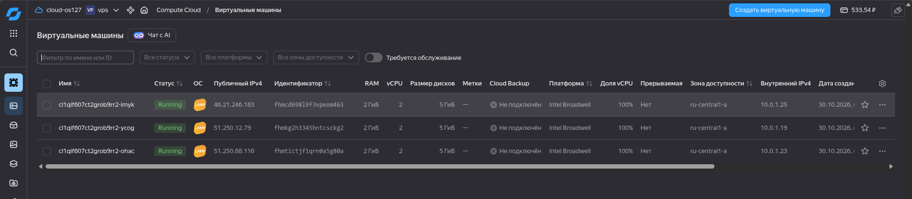
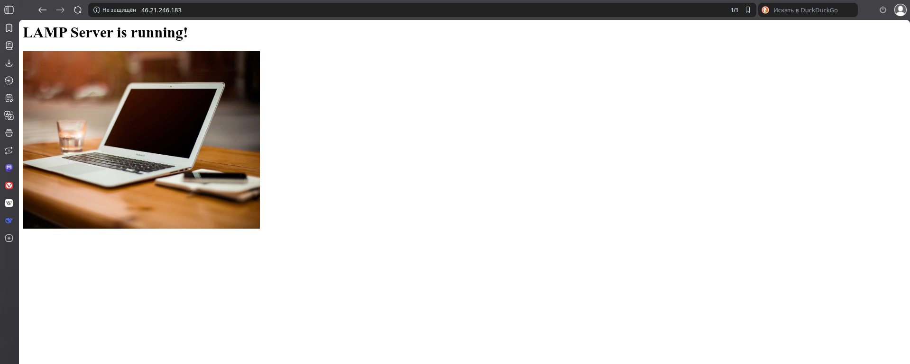
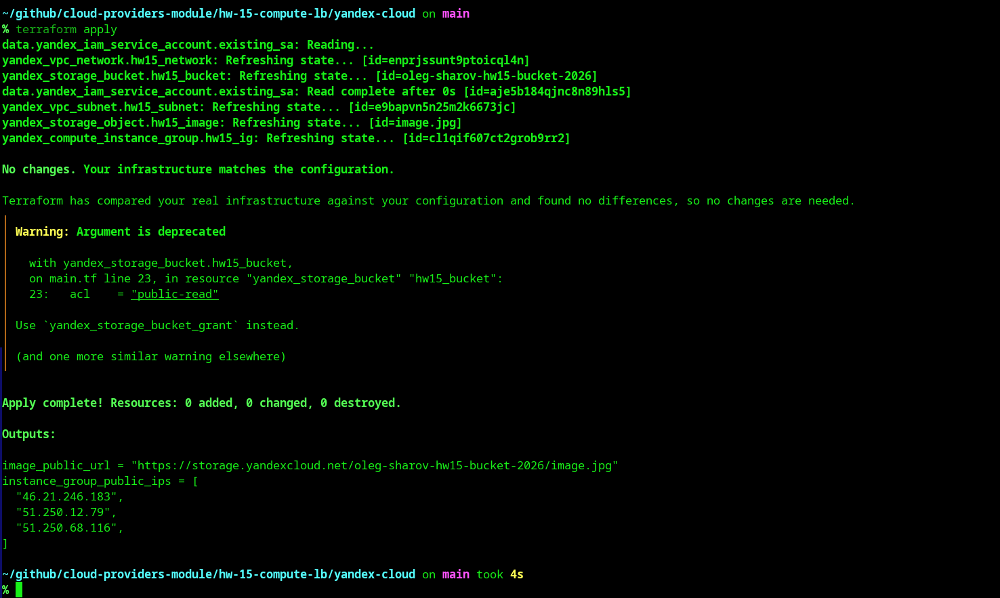
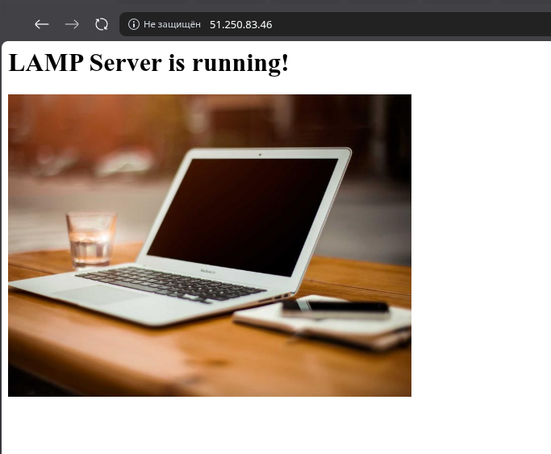
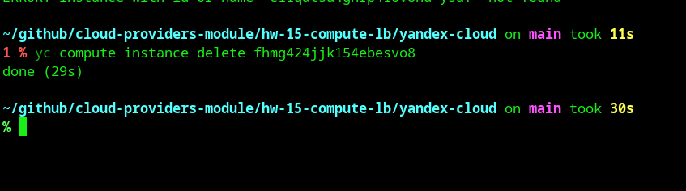
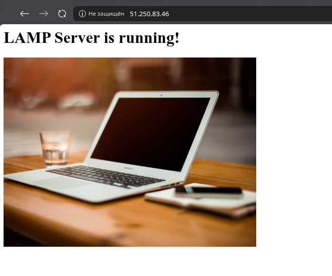
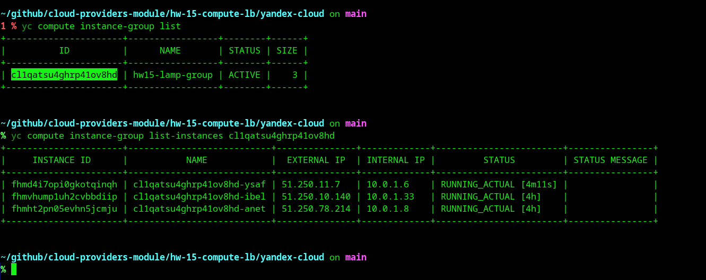

# Домашнее задание к занятию «Вычислительные мощности. Балансировщики нагрузки» - Шаров Олег

## Задание 1. Yandex Cloud

### 1.1. Создание бакета Object Storage и загрузка картинки

**Код:** [yandex-cloud/main.tf](./yandex-cloud/main.tf) (блоки `yandex_storage_bucket` и `yandex_storage_object`)

**Публичная ссылка на изображение:** 
https://storage.yandexcloud.net/oleg-sharov-hw15-bucket-2026/image.jpg

**Скриншот:**

---

### 1.2. Создание группы ВМ с шаблоном LAMP

**Код:** [yandex-cloud/main.tf](./yandex-cloud/main.tf) (блок `yandex_compute_instance_group`)

**Публичные IP-адреса ВМ:**
- 51.250.82.223
- 51.250.78.214
- 51.250.10.140

**Скриншоты:**
1. Список ВМ в консоли Яндекс Облака:

2. Веб-страница Apache на одной из ВМ:

3. Вывод команды terraform apply:

---

### 1.3. Подключение группы к сетевому балансировщику и проверка отказоустойчивости

**Код:** [yandex-cloud/main.tf](./yandex-cloud/main.tf) (блоки `yandex_lb_target_group` и `yandex_lb_network_load_balancer`)

**Публичный IP балансировщика:** 51.250.83.46

**Скриншоты:**
1. Работа балансировщика (все 3 ВМ активны):

2. Удаление одной из ВМ через CLI:

3. Работа балансировщика после удаления ВМ (трафик переключился на здоровые ноды):

4. Автоматическое восстановление Instance Group (новая ВМ создана за 4 минуты):
