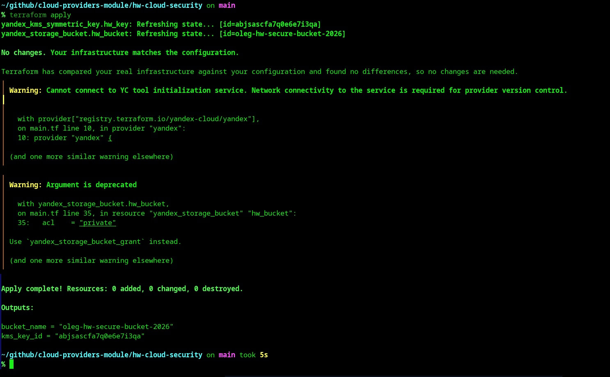
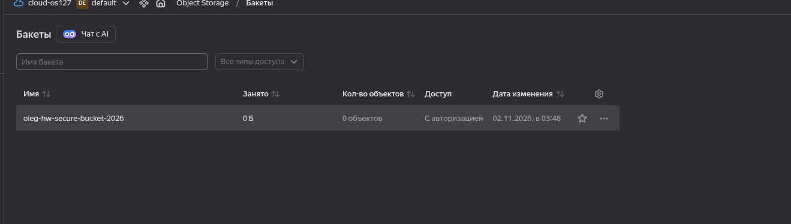
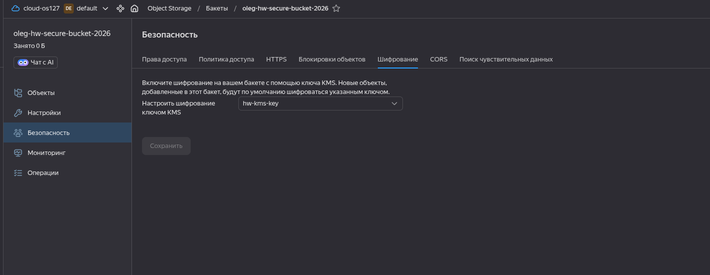
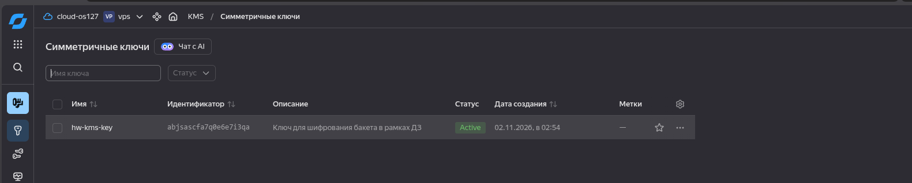

# Домашнее задание к занятию «Безопасность в облачных провайдерах» - Шаров Олег

## Задание 1. Yandex Cloud: Шифрование бакета с помощью KMS

### Описание
В рамках задания был создан симметричный ключ в Yandex Key Management Service (KMS) и настроено шифрование бакета Object Storage на стороне сервера (SSE-KMS) с использованием этого ключа.

### Конфигурация Terraform

#### `main.tf`
```hcl
terraform {
  required_providers {
    yandex = {
      source  = "yandex-cloud/yandex"
      version = ">= 0.130.0"
    }
  }
}

provider "yandex" {
  cloud_id  = var.cloud_id
  folder_id = var.folder_id
  zone      = "ru-central1-a"
}

resource "yandex_kms_symmetric_key" "hw_key" {
  name              = "hw-kms-key"
  description       = "Ключ для шифрования бакета в рамках ДЗ"
  default_algorithm = "AES_256"
  rotation_period   = "8760h"
}

resource "yandex_storage_bucket" "hw_bucket" {
  bucket = "oleg-hw-secure-bucket-2026" # Заменено на уникальное имя
  acl    = "private"

  server_side_encryption_configuration {
    rule {
      apply_server_side_encryption_by_default {
        kms_master_key_id = yandex_kms_symmetric_key.hw_key.id
        sse_algorithm     = "aws:kms"
      }
    }
  }
}

output "kms_key_id" {
  value       = yandex_kms_symmetric_key.hw_key.id
  description = "ID созданного KMS-ключа"
}

output "bucket_name" {
  value       = yandex_storage_bucket.hw_bucket.bucket
  description = "Имя созданного зашифрованного бакета"
}
```

#### `variables.tf`
```hcl
variable "cloud_id" {
  description = "ID облака Yandex Cloud"
  type        = string
}

variable "folder_id" {
  description = "ID каталога (folder) Yandex Cloud"
  type        = string
}
```

### Результаты выполнения

### Результаты выполнения

1. Проверка состояния инфраструктуры через Terraform:

*Примечание: на скриншоте показан вывод `terraform apply` для существующей инфраструктуры, подтверждающий корректные выходные параметры (Outputs) созданного ключа и бакета.*

2. Бакет создан и отображается в консоли Object Storage:


3. Настройки шифрования бакета в консоли (вкладка "Безопасность" → "Шифрование"):


4. Созданный ключ в Yandex KMS:
